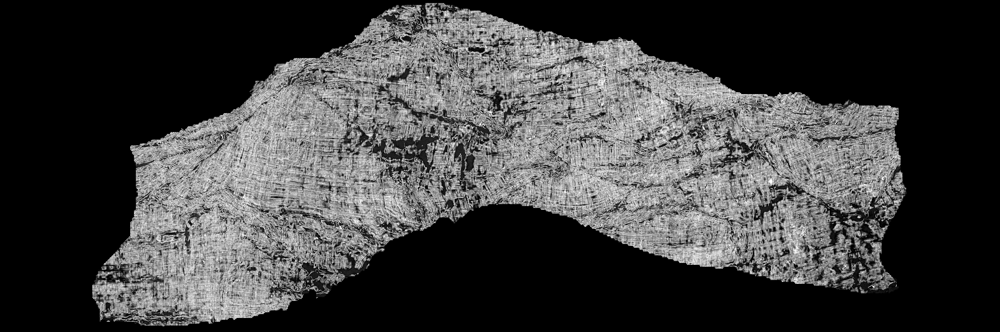
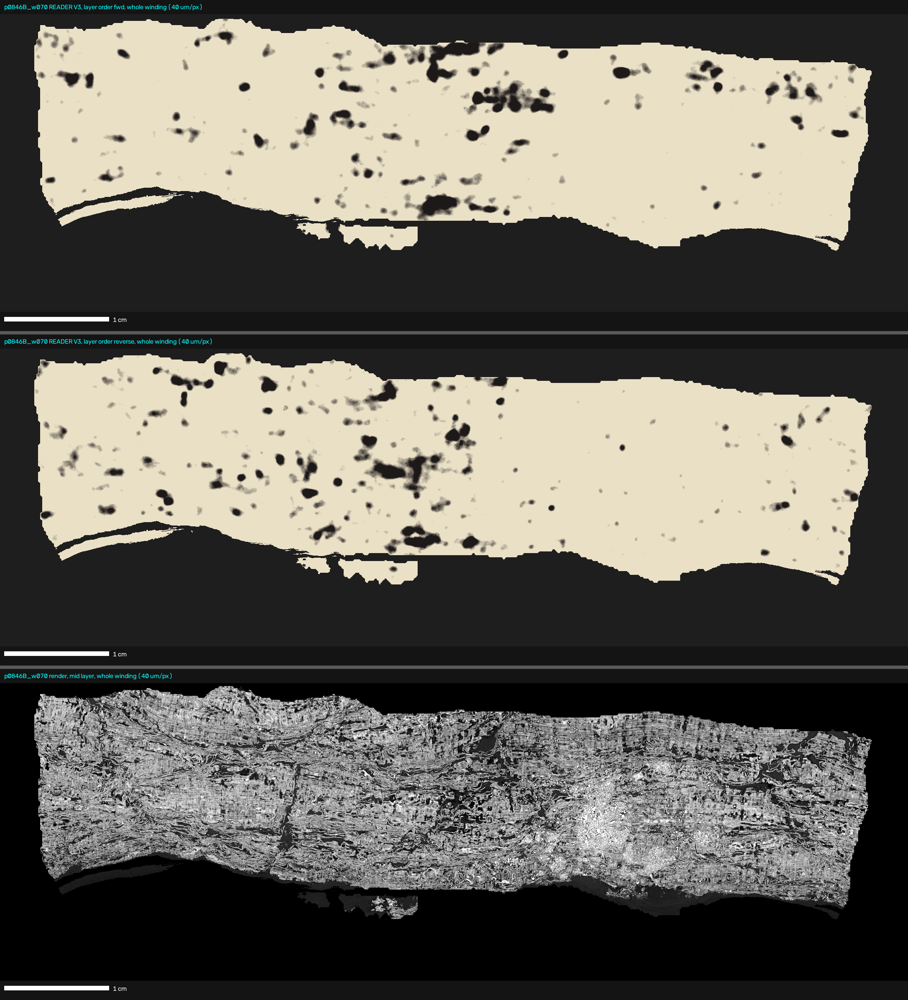

# Spiral-fit inputs and first windings for PHerc. 1203, 1218, 1545 and 0846B

Spiral-fit input tracks for four Herculaneum scrolls that had none, an 8,000-step spiral fit run on each of them, three windings from each fit, renders of those twelve windings, and Reader V3 ink maps of all twelve.

Authors: Jack Gilman and Andrew Gilman. Data licence: CC BY-NC 4.0 (see `LICENSE-DATA`). The Vesuvius Challenge scans these files derive from are CC BY-NC 4.0 too; please credit the Vesuvius Challenge as well as us.



*PHerc. 1545, winding 070 (5-layer mean, quarter scale). The fine criss-cross texture is papyrus fibre.*



*PHerc. 0846B, winding 070: Reader V3 in both layer orders (dark = what the reader calls ink) above the render at the same scale. Blobs, no letters.*

## What this shows

1. **All four scrolls now have a spiral fit that ran to the end on these tracks.** For PHerc. 1545, 1218, 1203 and 0846B we ran the villa spiral fit for 8,000 steps (one 1,500-slice band each). The loss fell by about 96 percent on all four. On each, we then took three windings from the middle of the fit and snapped them onto the scroll's predicted sheets: on PHerc. 1545 and 1218 every point that had a sheet nearby snapped; on PHerc. 0846B that share was 97 percent and on PHerc. 1203 it was 89 to 94 percent.
2. **The windings sit on real papyrus.** We rendered 31 layers of each of those twelve windings from the CT. Over most of the surface they show a crossing weave of horizontal and vertical papyrus fibres, with a minority of dark voids and folded or swirled patches. PHerc. 0846B is the roughest of the four to look at: many dark tears along the winding and one bright, gritty patch a few centimetres wide. (This is our own look, one reader, by eye.)
3. **Reader V3 draws scattered blobs and short chains, and no letters.** We ran Reader V3 over all twelve windings, in both layer orders. On every one the dark marks are isolated round or oval blobs about 0.3 to 2 mm across plus a few short irregular chains. We saw no row of separate letter-sized forms with even spacing on any of the 24 maps. These maps are descriptive. They are not a test of ink and we make no claim that any text was found.
4. **PHerc. 0846B is the one scroll here where we also built the inputs ourselves.** The other three fits used a community umbilicus and published surface normals. For 0846B we built the umbilicus and made the normals ourselves, so its fit is also a first test of those inputs. It ran to the end and its windings snap (97 percent of the points that had a sheet), so the inputs work for the fit; they are weaker than for 1545 and 1218 (fewer points have a sheet, more tears), and the 0846B normals are not part of this release.

Why this might be useful: for these four scrolls the public spiral dataset (`dl.ash2txt.org/datasets/spiral_datasets/`) has no tracks. We checked the listing on 2026-11-13 and none of the four is there, and a GitHub search the same day found no one publishing tracks for them. Without tracks the "winners' lane" (below) cannot start on these scrolls except by extracting tracks yourself, which took 1.1 to 1.9 hours of laptop time per scroll for us. The fit result above is evidence that these tracks are good enough to use.

## What is in this release

One 1,500-slice band per scroll. The tracks were extracted over the band plus 300 slices on each side.

| Scroll | Band (slices) | Extracted over | Voxel size | Tracks | Points | Umbilicus | Fit and windings? |
|---|---|---|---|---|---|---|---|
| PHerc. 1545 | 5300-6800 | 5000-7100 | 9.362 um | 3,078,285 | 100,620,425 | Drobkov | yes |
| PHerc. 1218 | 6900-8400 | 6600-8700 | 8.640 um | 2,306,289 | 80,029,782 | Drobkov | yes |
| PHerc. 1203 | 11500-13000 | 11200-13300 | 9.362 um | 1,752,396 | 98,740,687 | Drobkov | yes |
| PHerc. 0846B | 11500-13000 | 11200-13300 | 9.362 um | 4,049,968 | 137,923,960 | built by us from public normal grids | yes |

Per scroll you get the track store in the format the villa fitter reads (nine flat files, `.dbm.vctracks`), the source store it was packed from (`.dbm`), the crossings cache (`.crossings.npz`), the extraction log and a small `extract_done.json` with the parameters. You also get the umbilicus file and the job file we used for the fit. For each scroll there are also the fit outputs and the three rendered windings, as ZIP archives: one archive per scroll with the fit checkpoint, meshes, snap reports, flattened sheets, logs and the other non-render outputs (about 0.3 to 0.45 GB), and one archive per rendered winding with its 31-layer render (about 0.4 to 0.59 GB each). A last archive, `ink-maps-and-pictures.zip` (84 MB), holds the 24 whole-winding and centre close-up Reader V3 pictures and the proof pictures of all four scrolls. The raw Reader V3 maps are not in the release. `MANIFEST.md` lists every file with its size and SHA-256, and how each large file would be split or compressed for release.

Track files per scroll (store, source store, crossings cache and logs together): 2.34 GB for PHerc. 1218, 2.85 GB for 1203, 2.94 GB for 1545 and 4.01 GB for 0846B, 12.1 GB in all; see `MANIFEST.md`. Each single file is under GitHub's 2 GiB release-asset limit, so no file has to be split.

### Correction, 2026-11-21: scale in the fitted and snapped meshes' meta.json

The `meta.json` files of the fitted meshes (`fit/.../meshes/fitted_*`) and the snapped windings (`snap/w069`-`w071`) inside the four `*_proof_fit-flat-mesh-snap.zip` archives say `"scale": [0.05, 0.05]`, which means one grid step is 20 voxels. The real node spacing of those meshes is 23 to 31 voxels, depending on the scroll (PHerc. 1218 `snap/w070`: 29.3 x 30.6). Their `area_vx2` and `area_cm2` were computed from the wrong step, so they are too small. The mesh coordinates themselves (`x/y/z.tif`) are correct. The release asset `meta-fix-2026-11-21.zip` holds the 972 corrected `meta.json` files at the same paths: unzip it over the extracted archives. The flattened windings, the renders, the ink maps and every number in this README are not affected. Thanks to rekoj4715 on the Vesuvius Challenge Discord for spotting it.

## How the tracks were made

With the villa project's own track extractor (`extract_surface_tracks`, then `convert_track_store` and `build_track_crossings`), run unchanged on the public m7 surface prediction of each scroll, with the parameters used for the published PHerc. 0358 tracks: downsample factor 2, z chunk depth 2 and stride 8, yx chunk thickness 4 and stride 16, dust threshold 400, max area threshold 640,000, path mode `interjoint`. We ran it on a laptop (4 worker processes, CPU only, WSL Ubuntu), 1.1 to 1.9 hours per scroll. No GPU and no paid compute was used for the tracks.

The fits were run on a rented RTX 4090 pod (65, 71, 67 and 90 minutes; USD 0.96 for 1545, 1.05 for 1218, 1.00 for 1203 and 1.33 for 0846B, USD 4.34 in all), one fit per scroll, 8,000 steps, one sense (anticlockwise outward, the catalogue prior), then snapping, flattening and rendering of three windings (069, 070, 071) with 31 layers each. The 0846B run is the longest because the pod also made that scroll's surface normals (about 12 minutes for 320 tiles); the fit itself took about 37 minutes at 3.2 to 3.6 steps per second and used 16.5 to 16.7 GB of GPU memory. The ink maps were made afterwards on a laptop GPU (Intel Arc, FP32); we first checked that the GPU and a CPU run of the same six tiles agree (largest difference 7e-7).

## Try it on a scroll: the PHerc. 0306B winners' lane

The PHerc. 0306B First Letters winners published their screening scripts in `SirProdigle/pherc0306b-first-letters`. Their data step (`discovery/x_recipe_erwin/remote/erwin_data.sh`) downloads tracks from `dl.ash2txt.org`, which has nothing for these four scrolls. We propose a small change that lets that step read tracks from another base URL ([pull request 7](https://github.com/SirProdigle/pherc0306b-first-letters/pull/7) on their repository; until it is merged, apply the one-line change in `winners-lane-test/diff_before_after.txt`). With it, in outline:

```
# 1. download one scroll's tracks from this release into a folder, in the dl.ash2txt.org layout
bash fetch_tracks.sh https://github.com/Ahggggg/spiral-tracks-four-scrolls/releases/download/v1 PHerc1545 /data/spiral_tracks
# 2. run their data step with the new option, pointing at that folder
TRACKS_BASE=file:///data/spiral_tracks bash erwin_data.sh PHerc1545 5300 6800 ACW umbilicus_PHerc1545_drobkov.json
```

`fetch_tracks.sh` is in this repository. It exists because GitHub release downloads cannot hold folders and answer with a redirect that the winners' downloader does not follow; it fetches the nine store files and the source file, checks their sizes, and arranges them as `<folder>/<scroll>/<volume id>/tracks/...`. `TRACKS_BASE` can also be an HTTP mirror with that layout.

What we tested, said plainly. On 2026-11-13 we ran their `erwin_data.sh` (commit `feabff6`) on PHerc. 1545, z 5300-6800. Unchanged, its tracks stage prints `DOWNLOAD FAILED` for each of the nine files and stops with `tracks download failed`. With the one-line `TRACKS_BASE` change, pointed at a folder and at a local HTTP mirror, their own code fetched all nine files at the right sizes and went on to the next stage. That test covers the tracks stage only (the bucket downloads after it were stubbed out). **The fits reported above were run through our own copy of the pipeline, not through the winners' scripts**: same villa fitter and settings, different wrapper. On 2026-11-15, after publishing, we ran `fetch_tracks.sh` against this release for PHerc. 1545 (ten files, all ten SHA-256 sums match `SHA256SUMS.txt`) and then their data step with `TRACKS_BASE=file://` on that folder; output in `winners-lane-test/real_release_fetch_and_erwin_data_PHerc1545.txt`. The downloads for the other three scrolls were not run.

PHerc. 0846B differs from the other three: its fit used an umbilicus we built ourselves (in this release) and normals made from the m7 surface prediction with the winners' `make_normals.py` (not in this release). No lasagna normals are published for 0846B; `erwin_data.sh` builds the synthetic normals itself in that case (read from its code; we did not run that part of their script).

Volume ids and umbilicus sources:

| Scroll | Volume id | Umbilicus file |
|---|---|---|
| PHerc. 1545 | 20250821151648 | Drobkov, 1545 file |
| PHerc. 1218 | 20250521120456 | Drobkov, 1218 file |
| PHerc. 1203 | 20250820131727 | Drobkov, 1203 file |
| PHerc. 0846B | 20250804142305 | built by us (`umbilicus_PHerc0846B_ngrid.json`) |

## Results per scroll (three middle windings, 069, 070, 071)

All numbers were read from the fit logs and snap reports of these runs. "Share with a sheet" is the fraction of valid points on the fitted winding for which a predicted sheet of the scroll was found nearby. "Share snapped" is the fraction of those that snapped onto it. "Median offset" is how far, in voxels, the snap moved the median point. "Area" is the rendered area of one winding.

| | PHerc. 1545 | PHerc. 1218 | PHerc. 1203 | PHerc. 0846B |
|---|---|---|---|---|
| Loss at step 0 | 7,532 | 7,394 | 6,202 | 6,275 |
| Loss at step 7,800 | 273 | 262 | 235 | 224 |
| Share with a sheet (069 / 070 / 071) | 0.928 / 0.927 / 0.927 | 0.943 / 0.944 / 0.944 | 0.870 / 0.842 / 0.839 | 0.842 / 0.845 / 0.859 |
| Share snapped, of those | 1.000 / 1.000 / 1.000 | 1.000 / 1.000 / 1.000 | 0.940 / 0.897 / 0.887 | 0.968 / 0.968 / 0.972 |
| Median offset, voxels | 2.06 / 1.86 / 1.78 | 2.12 / 1.98 / 1.91 | 2.89 / 2.79 / 2.01 | 2.65 / 2.79 / 2.17 |
| 90th-percentile offset, voxels | 5.07 / 4.81 / 4.85 | 4.90 / 4.82 / 4.71 | 7.33 / 6.00 / 5.47 | 7.75 / 7.31 / 6.09 |
| Valid points (069 / 070 / 071) | 25,025 / 25,326 / 25,685 | 23,977 / 24,267 / 24,642 | 23,814 / 24,098 / 24,448 | 25,762 / 26,137 / 26,509 |
| Rendered area per winding | 8.62 / 8.72 / 8.85 cm2 | about 13.6 to 14.0 cm2 | 12.4 / 12.5 / 12.6 cm2 | about 13.5 / 13.7 / 13.8 cm2 |
| Render size (31 layers, rows x columns) | about 3,450 x 10,500 px | about 3,650 x 11,300 px | about 2,600 x 9,000 px | 2,780 x 9,140 / 3,040 x 9,280 / 2,700 x 9,360 px |
| Reader V3 valid pixels per map | 17.1 / 17.4 / 17.7 Mpx | 18.26 / 18.51 / 18.82 Mpx | 14.17 / 14.20 / 14.37 Mpx | 15.38 / 15.62 / 15.80 Mpx |
| Ink maps show a letter row? | no | no | no | no |

For PHerc. 0846B the fit left 11.2 percent of its 3,095,116 tracks (347,101) satisfied, and 54.4 percent of the track points; the notes this table was made from have no matching figures for the other three scrolls.

What the ink maps do and do not say. Every map shows scattered blobs and short chains. In the two layer orders of one winding the blobs mostly do not fall in the same places. The one exception, a cluster of streaks about 1.5 cm wide near the lower edge of PHerc. 1218 winding 069, appears in both orders; at 20 um per pixel it is made of smears stretched along the winding, not of separate forms. We do not know which of the two layer orders is the reading side. The crumpled patch in the middle of the PHerc. 1218 renders is not denser in the ink maps than the surface around it. We looked by eye, one reader, at the whole-winding picture of every one of the twelve windings (both layer orders in each) but at only some of the 20 um close-ups (none of the PHerc. 0846B close-ups). On PHerc. 0846B the two orders of a winding share a few positions (for example a pair of blobs near the lower edge left of centre on windings 069 and 070) but not their shapes; the bright gritty patch right of centre in its renders is the emptiest part of every one of its maps, so it does not draw as a cluster.

## Measured limits

- **One band per scroll in this release.** Each scroll has one 1,500-slice band (plus margin). Whole-length tracks for all four scrolls also exist now (53 overlapping bands from slice 0 to the top of each scroll, about 96 million tracks, about 110 GB; made on the same laptop with the same extractor settings, and each band's packed store matches its source store and its crossings cache loads). They are too large for GitHub release assets, so they are not attached; we would gladly hand them over for hosting beside the other tracks on dl.ash2txt.org. None of the other bands has been fitted. The top band of PHerc. 1545 and of PHerc. 1203 needed the thin-last-ribbon guard proposed in ScrollPrize/villa pull request 2406, because the unpatched extractor stops there with an error.
- **PHerc. 0846B is weaker than 1545 and 1218, and comparable to 1203.** Its umbilicus and its surface normals are home-built (the normals were made with `make_normals.py` from the public m7 surface prediction, on the pod, and are not in this release); this one fit is their only test. Fewer of its points have a sheet nearby (84 to 86 percent against 93 to 94 for 1545 and 1218), the snap moved the median point 2.2 to 2.8 voxels and the 90th-percentile point 6.1 to 7.8, and its renders show many dark lens-shaped tears along the winding, one near-vertical crack left of centre and one bright, gritty patch about 2 to 3 cm wide right of centre. The Reader V3 maps are nearly empty over that patch. We looked at two of the three renders by eye at quarter scale (one reader), not at full-resolution crops.
- **PHerc. 1203 is the weakest of the three Drobkov-umbilicus scrolls.** Fewer points have a sheet nearby (84 to 87 percent against 93 to 94), more of those fail to snap (6 to 11 percent), the offsets are larger, and its renders show more gaps. Its fit log also warns that the outer-winding setting needs a larger winding-expander count than the default; the shell loss weight is 0, so we do not think this changed the fit, but we did not test that.
- **Our extractor agrees only partly with the published one on vertical tracks.** On the PHerc. 0358 control, where published tracks exist, track agreement for vertical (slab) tracks was 67 to 78 percent; horizontal ribbon tracks matched better. We do not know how much this matters for the fit; the fits above ran regardless.
- **The umbilici were checked only by the fit.** The three Drobkov umbilici are community annotations we did not re-check. The PHerc. 0846B umbilicus we built ourselves from public normal grids, and nothing independent has checked it; the one fit that used it ran to the end and its windings snap, which is the only check it has had.
- **The fits are one run each.** One seed, one sense, one 8,000-step run per scroll, three windings snapped and rendered. We have not repeated any of them and have not compared against an independent reconstruction of the same windings.
- **Nobody outside has run these files yet.** Everything here was run by us.
- **No text was found.** The ink maps are descriptive and make no claim about writing.

## A note on identifiers inside some files

A few small files in the fit archives mention short codes such as `X-153`, `C-018`, `T-304` or `T-305`. These are references into our own lab notebook (experiment, claim and task numbers). They are not links, you cannot look them up, and they name no person or path. They appear in each winding's `mesh/wNNN.reading_side.json`, in `logs/render.wNNN.side.log`, in each render's `.zattrs` (the tool string) and, for PHerc. 0846B, in `dataset/umbilicus.json` (the tool string of the script that built it). We left them as made so the files stay byte-identical to what the pipeline wrote. The binary `.pt` and `.ckpt` files were not read for such codes. Paths starting `/workspace/` inside the logs and JSON files are folders on the rented pod.

## Credits

- **Vesuvius Challenge** and the ESRF: the scans, the m7 surface predictions, Lasagna normals and the open-data bucket.
- **villa** (`ScrollPrize/villa`, MIT): the track extractor, the spiral fitter and the renderer.
- **Alexey Drobkov** (`AlexeyDrobkovStrikesBack/herculaneum-umbilici`, MIT): the umbilicus annotations for PHerc. 1203, 1218 and 1545.
- **The PHerc. 0306B winners, Liam Warner and Nicola Bodill** (`SirProdigle/pherc0306b-first-letters`): the screening recipe and scripts we followed, built on Erwin Nieuwlaar's PHerc. 343 recipe.
- **ivanmikhnenkov**: the merged fixes to the winners' data step (tracks download checks) and lane scripts that this route relies on.
- **domenicor046**: Reader V3.

## Licence

Data (tracks, umbilicus for PHerc. 0846B, job files' outputs, pictures): CC BY-NC 4.0. Code (job files, helper scripts): MIT (see `LICENSE`).

## Contact

Discord (Vesuvius Challenge server): `ahggggg`. Or open an issue on this repository.
